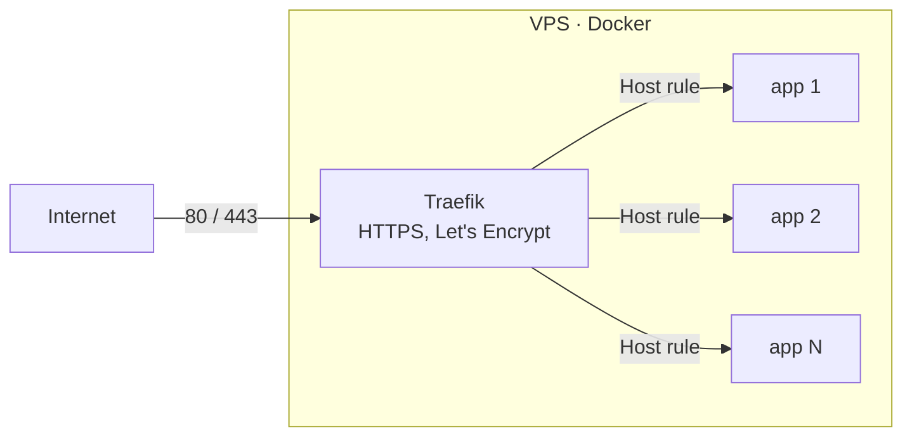

# docker-apps

Self-hosted services I run on my VPS: each app is a small Docker Compose project behind a single **Traefik** reverse proxy with automatic HTTPS.


## Architecture



- One shared external network `proxy`: Traefik finds apps by Docker labels, no ports are published except 80/443
- Every app lives in its own folder with `docker-compose.yml`, `.env.example` and a README
- Secrets stay in `.env` on the server, never in git
- `restart: unless-stopped`, healthchecks and memory limits for every service

## Apps

| App | What it does | Folder |
|---|---|---|
| *coming soon* | | |

## Add a new app

```bash
cp -r _template apps/<name>
cd apps/<name>
# rename "myapp" in docker-compose.yml, describe the app in README.md
cp .env.example .env   # fill in real values on the server
docker compose up -d
```

## Checks

Every push runs GitHub Actions:

- `docker compose config` for every compose file
- [gitleaks](https://github.com/gitleaks/gitleaks) scan, so a password or token never lands in the repository
