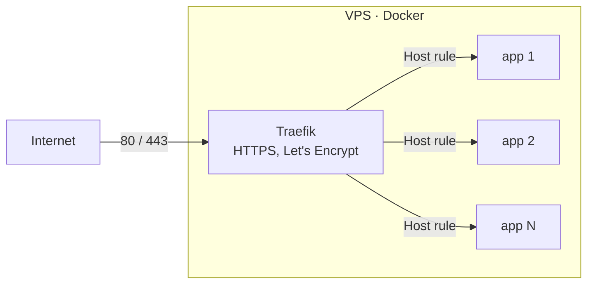

# docker-apps

Self-hosted services I run on my VPS: each app is a small Docker Compose project behind a single **Traefik** reverse proxy with automatic HTTPS.


## Architecture



- One shared external network `proxy`: Traefik finds apps by Docker labels, no ports are published except 80/443
- Every app lives in its own folder with `docker-compose.yml`, `.env.example` and a README
- Secrets stay in `.env` on the server, never in git
- `restart: unless-stopped`, healthchecks and memory limits for every service
- Databases and caches live in a per-app `internal` network and are never published
- Stateful apps have a backup sidecar ([docker-volume-backup](https://github.com/offen/docker-volume-backup)): nightly archive of the volumes to WebDAV storage with 7-day retention; it stops only the containers of its own app (per-app label value)

## Apps

| App | What it does | Folder |
|---|---|---|
| Traefik | Reverse proxy, Let's Encrypt certificates, HTTP → HTTPS | [apps/traefik](apps/traefik) |
| Monitoring | Prometheus, Alertmanager → Telegram, Grafana, Loki + Promtail, node-exporter, cAdvisor | [apps/monitoring](apps/monitoring) |
| Uptime Kuma | Status page and uptime checks | [apps/uptime-kuma](apps/uptime-kuma) |
| Vaultwarden | Password manager (Bitwarden-compatible) with nightly backups | [apps/vaultwarden](apps/vaultwarden) |
| n8n | Workflow automation | [apps/n8n](apps/n8n) |
| Paperless-ngx | Document archive with OCR | [apps/paperless](apps/paperless) |
| WordPress | WordPress + MySQL, tuned PHP, nightly backups | [apps/wordpress](apps/wordpress) |
| Planka | Kanban board with nightly backups | [apps/planka](apps/planka) |
| Vikunja | Task manager | [apps/vikunja](apps/vikunja) |
| FreshRSS | RSS reader + RSS-Bridge | [apps/freshrss](apps/freshrss) |
| Mealie | Recipes and meal planning | [apps/mealie](apps/mealie) |
| Memos | Lightweight notes | [apps/memos](apps/memos) |
| RustFS | S3-compatible storage for Terraform state (native lock file) | [apps/rustfs](apps/rustfs) |
| Actual Budget | Personal finance and budgeting, nightly backups | [apps/actual-budget](apps/actual-budget) |
| Wekan | Kanban board on MongoDB, nightly backups | [apps/wekan](apps/wekan) |
| Matrix | Synapse homeserver + PostgreSQL + Element web client, nightly backups | [apps/matrix](apps/matrix) |
| MTProto proxy | Private Telegram proxy with Fake TLS (mtg) | [apps/mtproxy](apps/mtproxy) |
| GitLab Runner | CI runner with the Docker executor, plus Helm values for Kubernetes | [apps/gitlab-runner](apps/gitlab-runner) |

## Add a new app

```bash
cp -r _template apps/<name>
cd apps/<name>
# rename "myapp" in docker-compose.yml, describe the app in README.md
cp .env.example .env   # fill in real values on the server
docker compose up -d
```

## Checks

Every push runs GitHub Actions:

- `docker compose config` for every compose file
- `promtool`, `amtool` and `loki -verify-config` for the monitoring stack
- [gitleaks](https://github.com/gitleaks/gitleaks) scan, so a password or token never lands in the repository
