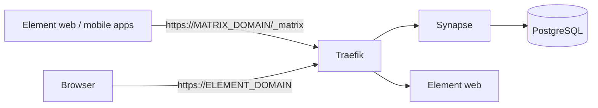

# Matrix (Synapse + Element)

Self-hosted messenger: [Synapse](https://github.com/element-hq/synapse) homeserver on PostgreSQL and the [Element](https://element.io) web client.



## Run

```bash
cp .env.example .env                       # domains + 4 random secrets
cp element/config.json.example element/config.json   # put MATRIX_DOMAIN into base_url and server_name
cp backup.env.example backup.env
docker compose up -d
```

Create the first (admin) user:

```bash
docker exec -it synapse register_new_matrix_user -c /data/homeserver.yaml -a http://localhost:8008
```

Then log in at `https://<ELEMENT_DOMAIN>` or in any Matrix app with the server `https://<MATRIX_DOMAIN>`.

## How it works

- `synapse-init` runs once on every start: it renders `synapse/homeserver.yaml.template` with values from `.env` into the data volume and creates the signing key if it is missing. Secrets never get into git
- Open sign-up is off: users are created by the admin with `register_new_matrix_user`
- Synapse serves `/.well-known/matrix/server`, so federation works through 443 without opening 8448
- PostgreSQL uses C collation (required by Synapse) and lives only in the `internal` network
- The `backup` sidecar briefly stops Synapse and PostgreSQL every night and uploads the data volumes (media, signing key, database) over WebDAV

## Check

```bash
curl https://<MATRIX_DOMAIN>/_matrix/client/versions
curl https://<MATRIX_DOMAIN>/.well-known/matrix/server
```

Federation can be checked at https://federationtester.matrix.org.
