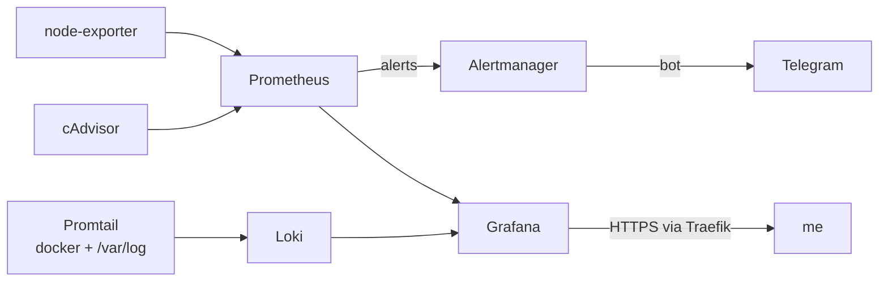

# Monitoring

Prometheus + Alertmanager + Grafana + Loki for the VPS: host metrics, per-container metrics and logs of every container in one place, alerts to Telegram.



## Run

```bash
cp .env.example .env
# Telegram alerts: bot token in a file (ignored by git), chat id in alertmanager.yml
echo -n '<bot token>' > alertmanager/telegram_token && chmod 600 alertmanager/telegram_token
docker compose up -d
```

## What's inside

- **Alerts** (`prometheus/alert.rules.yml`): high CPU, high memory, low disk, a scrape target down, a container restarting in a loop
- **Retention**: metrics 30 days, logs 14 days (Loki compactor)
- **Grafana** gets Prometheus and Loki as data sources automatically (provisioning); good dashboards to import: Node Exporter Full (1860), cAdvisor (14282)
- Only Grafana is reachable from the internet; Prometheus, Loki and the exporters have no published ports
